# Manual de usuario

Bolsa de Trabajo Departamental Digital del Gobierno Autónomo Departamental de Oruro (G.A.D.OR.).

Este manual explica, paso a paso, cómo usar el sistema según el tipo de usuario: postulante, empresa o administrador de la Gobernación.

## Contenido

1. [Antes de empezar](#1-antes-de-empezar)
2. [Postulante](#2-postulante)
3. [Empresa](#3-empresa)
4. [Administrador de la Gobernación](#4-administrador-de-la-gobernación)
5. [Preguntas frecuentes](#5-preguntas-frecuentes)

## 1. Antes de empezar

### 1.1 Cómo ingresar

1. Abre la dirección del sistema en el navegador (Chrome, Edge, Firefox o Safari), en la computadora o en el celular.
2. Sin iniciar sesión puedes ver las ofertas publicadas y su detalle.
3. Para postular, publicar ofertas o administrar, pulsa **Iniciar sesión**. Postulantes, empresas y administradores usan la misma pantalla de ingreso.

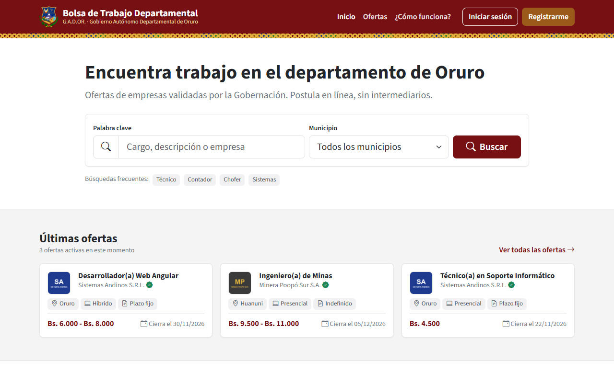

### 1.2 Instalar la aplicación en el celular

El sistema se puede instalar como una aplicación (PWA):

- **Android (Chrome):** abre el sistema, pulsa el menú de los tres puntos y elige **Instalar aplicación** o **Agregar a la pantalla principal**.
- **iPhone (Safari):** pulsa **Compartir** y luego **Agregar a inicio**.

Aparecerá el ícono de la Bolsa de Trabajo junto a tus otras aplicaciones.

| Menú de Chrome | Instalar | Ícono en el celular |
|---|---|---|
| 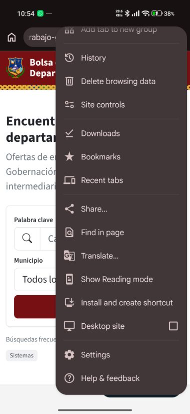 | 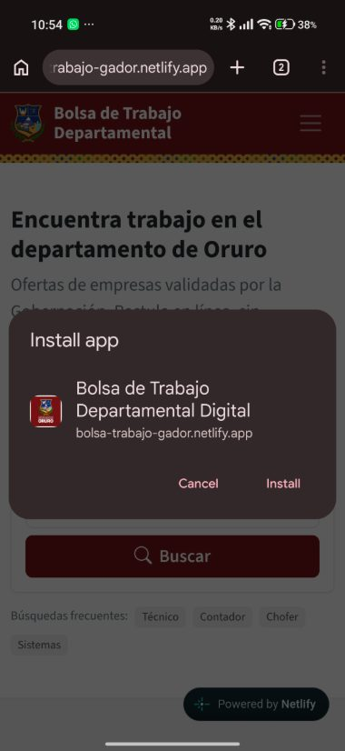 | 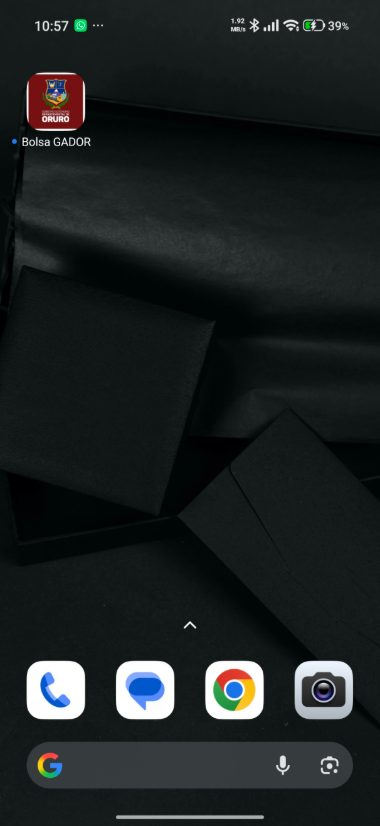 |
 Si te quedas sin conexión, verás un aviso con el botón **Reintentar**.

### 1.3 Olvidé mi contraseña

1. En **Iniciar sesión**, pulsa **¿Olvidaste tu contraseña?**.
2. Escribe tu correo y confirma.
3. Abre el correo que te llega y pulsa el enlace. El enlace sirve **una sola vez** y vence en **30 minutos**.
4. Escribe tu nueva contraseña dos veces y guarda.

Si fallas la contraseña **5 veces seguidas**, la cuenta se bloquea **15 minutos** por seguridad.

### 1.4 Cambiar la contraseña

1. Inicia sesión y pulsa el botón de la **llave** en la barra superior.
2. Escribe tu contraseña actual y la nueva dos veces.
3. Al guardar se cierran tus sesiones en todos los dispositivos, también en este, y debes volver a iniciar sesión.

La contraseña debe tener al menos **8 caracteres**, una **mayúscula**, una **minúscula** y un **número**.

### 1.5 Notificaciones

La **campana** de la barra superior muestra cuántos avisos tienes sin leer. Al pulsarla ves la lista; pulsa un aviso para ir a la pantalla relacionada o **Marcar todas como leídas**.

Además, cada aviso llega a tu **correo**. Para recibirlos también en el celular aunque la aplicación esté cerrada:

1. Entra a **Notificaciones** (la campana).
2. En **Avisos en este dispositivo**, pulsa **Activar avisos** y acepta el permiso del navegador.
3. Para dejar de recibirlos, pulsa **Desactivar**. Al cerrar sesión el dispositivo deja de recibir avisos de tu cuenta.

| Permiso del navegador | Aviso en el celular |
|---|---|
| 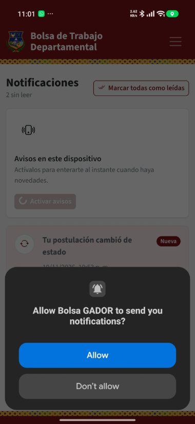 | 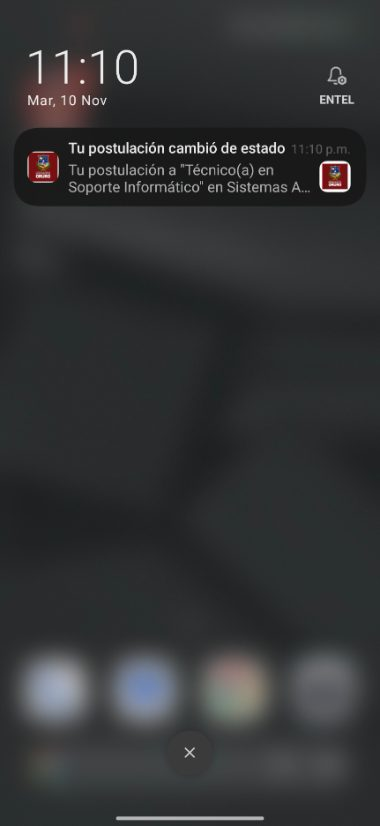 |

## 2. Postulante

### 2.1 Crear la cuenta

1. En la página de inicio pulsa **Crea tu cuenta** (o **Registrarme** en la barra superior).
2. Completa tus datos: cédula de identidad y lugar de expedición, nombres, apellidos, celular, correo y contraseña.
3. Acepta el uso de tus datos y pulsa **Continuar**.
4. Revisa tu correo: te llega un **código de 6 dígitos**. Si no lo ves, busca en **Spam** o **Promociones**.
5. Escribe el código y pulsa **Verificar correo**.
   - El código vence en **10 minutos** y admite **3 intentos**.
   - Puedes pedir otro código después de **1 minuto** (hasta 3 por hora).
   - Si escribiste mal tu correo, puedes corregirlo en esa misma pantalla.
6. Con el correo verificado, inicia sesión y entrarás a **Mi panel**.

> Una cuenta que no se verifica en 7 días se elimina, para liberar el CI y el correo.

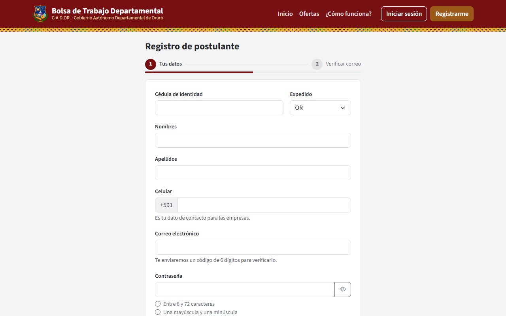

### 2.2 Completar la hoja de vida

Para postular necesitas un perfil con **más de 80 %** y tu **CV en PDF**. El porcentaje se ve en **Mi panel** y en **Mi perfil**.

| Sección | Suma |
|---|---|
| Datos personales | 20 % |
| Foto | 10 % |
| Formación académica | 20 % |
| Experiencia laboral | 15 % |
| Habilidades | 15 % |
| Idiomas | 5 % |
| CV en PDF | 15 % |

1. Entra a **Mi perfil**.
2. **Datos personales:** fecha de nacimiento (debes tener al menos 18 años), dirección, municipio, profesión y un resumen breve. Guarda.
3. **Foto:** elige una imagen PNG o JPG de hasta 2 MB.
4. **Formación académica:** pulsa agregar, escribe el título, la institución, el año y, si lo tienes, el número de título en provisión nacional.
5. **Experiencia laboral:** empresa, cargo, lugar, fechas y descripción. Deja la fecha de fin vacía si es tu trabajo actual.
6. **Habilidades:** elige cada habilidad y tu nivel (básico, intermedio o avanzado).
7. **Idiomas:** elige el idioma y tu nivel.
8. **CV en PDF:** sube tu hoja de vida en PDF de hasta **5 MB**. Puedes reemplazarla cuando quieras.

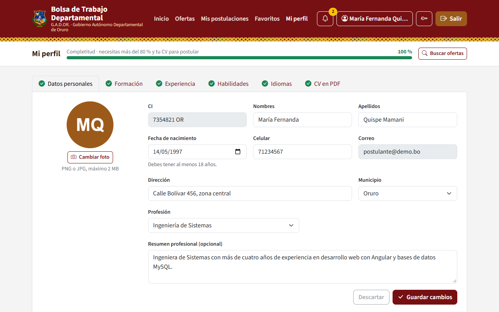

### 2.3 Buscar ofertas

1. Pulsa **Ofertas** en la barra superior (o busca desde la página de inicio).
2. Usa los **filtros**: palabra clave, profesión, salario mínimo, municipio y modalidad. Marca **Incluir salario «A tratar»** si quieres ver también las ofertas sin monto fijo.
3. Pulsa **Aplicar filtros** y elige el orden: más recientes, cierre más próximo o mayor salario.
4. Pulsa una oferta para ver el detalle: requisitos, habilidades obligatorias y deseables, salario, beneficios, fecha de cierre y datos de la empresa.
5. Pulsa el **corazón** para guardarla en **Favoritos**. Si una oferta guardada cierra al día siguiente, te llega un aviso.

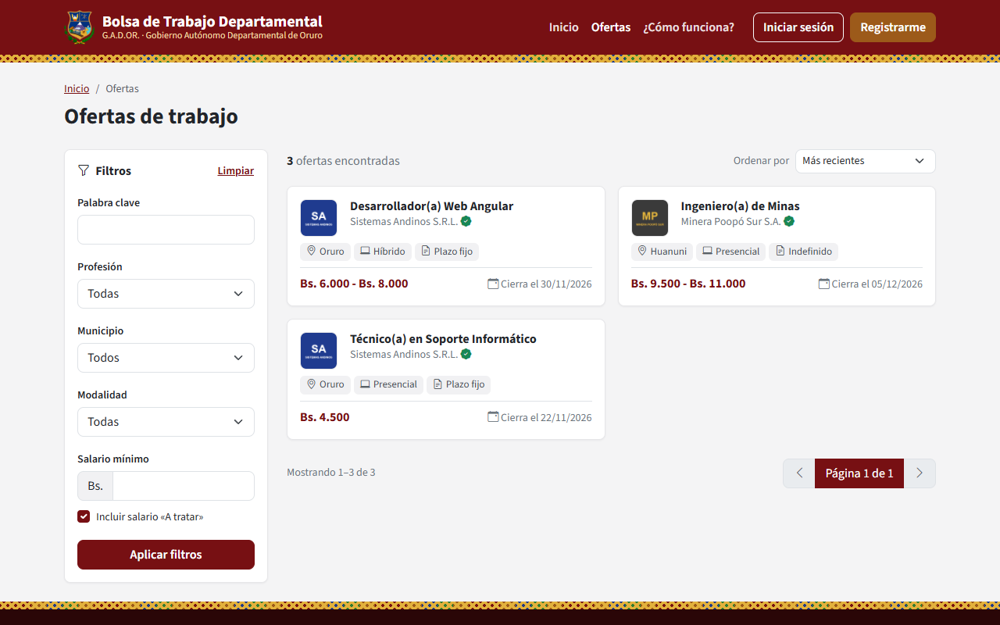

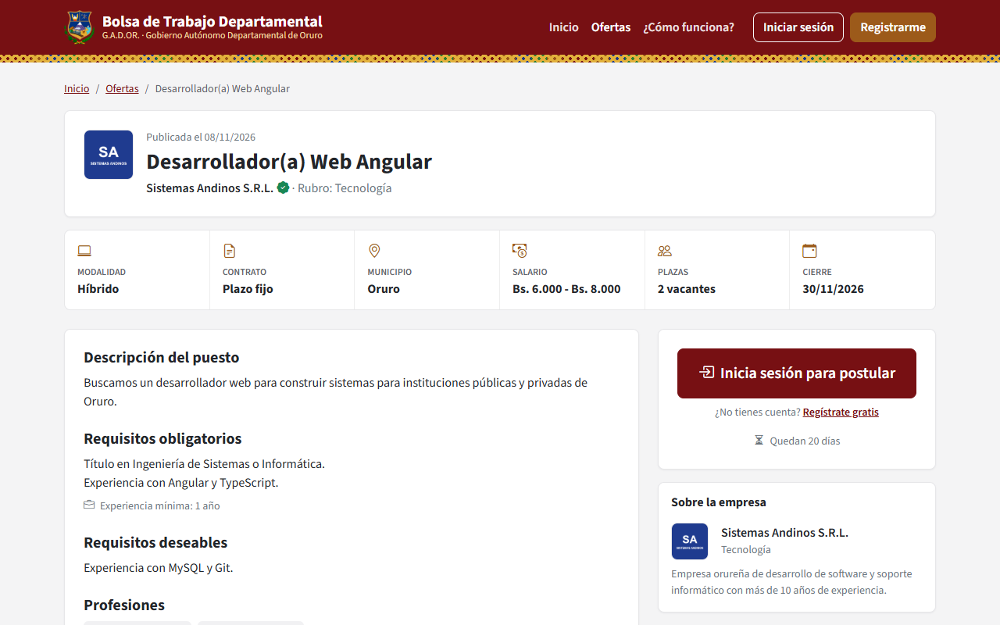

### 2.4 Postular

1. En el detalle de la oferta pulsa **Postular**.
2. El sistema muestra tu coincidencia con la oferta: qué habilidades obligatorias y deseables tienes.
3. Si te falta algo (perfil de más de 80 % o CV), verás qué completar y el botón **Completar mi perfil**.
4. Pulsa **Confirmar postulación**. Verás **¡Postulación enviada!** con tu porcentaje de coincidencia.

Solo se puede postular una vez a cada oferta, mientras esté publicada y antes de su fecha de cierre.

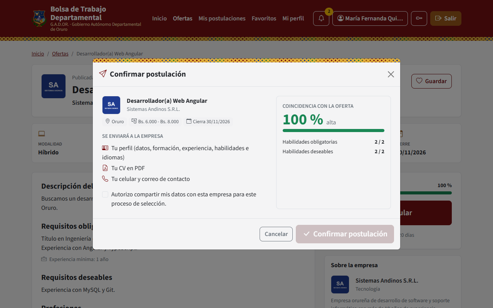

### 2.5 Seguir mis postulaciones

1. Entra a **Mis postulaciones**.
2. Verás cada oferta con la fecha, la coincidencia y el estado:

| Estado | Significado |
|---|---|
| Postulado | Tu postulación llegó a la empresa |
| Visto | La empresa abrió tu perfil |
| Preseleccionado | Pasaste el primer filtro |
| Entrevista | Te citarán a una entrevista |
| Finalista | Estás entre los últimos candidatos |
| Contratado | La empresa te eligió |
| Rechazado | No continúas en este proceso |
| Retirado | Retiraste tu postulación |

3. Cada cambio de estado te llega como aviso y por correo.
4. Para **retirar** una postulación, pulsa **Retirar**. Solo es posible mientras está en **Postulado** (antes de que la empresa la vea).

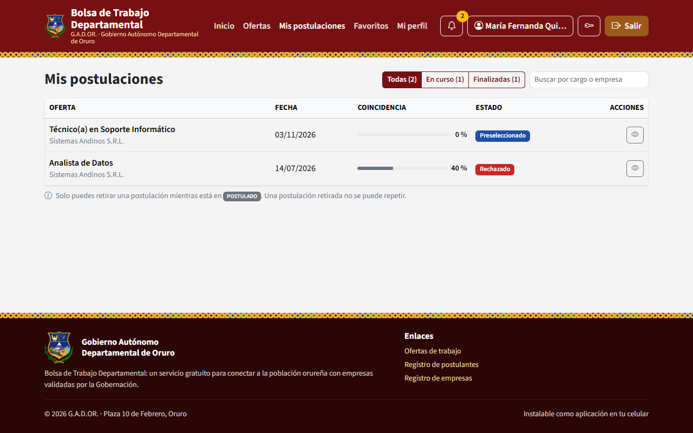

## 3. Empresa

### 3.1 Registrar la empresa

1. En la página de inicio pulsa **Registra tu empresa**.
2. Completa:
   - **Datos de la empresa:** NIT, razón social, rubro, logo (PNG o JPG de hasta 2 MB, opcional) y descripción.
   - **Representante legal:** nombre completo, CI y celular.
   - **Contacto:** correo corporativo, municipio y dirección.
   - **Documento de respaldo:** PDF del NIT, hasta 5 MB (obligatorio).
   - **Cuenta:** contraseña. Inicias sesión con el correo corporativo.
3. Acepta la declaración y envía. Verás **Solicitud enviada**.
4. La Gobernación revisa los datos y el documento. Mientras tanto puedes iniciar sesión y verás el aviso **Tu empresa está en revisión**.
5. Cuando la Gobernación decide, recibes un aviso y un correo:
   - **Aprobada:** ya puedes publicar ofertas.
   - **Rechazada:** verás el motivo en tu panel. Comunícate con la Unidad de Empleo de la Gobernación.

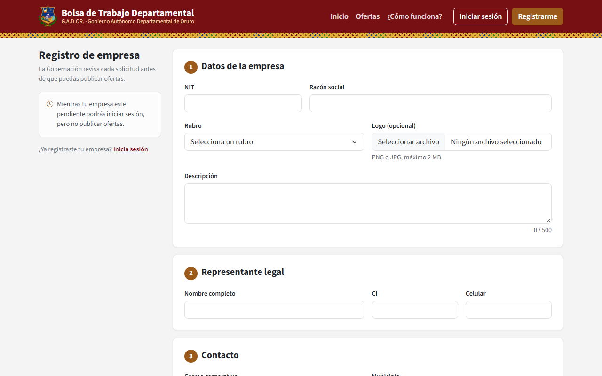

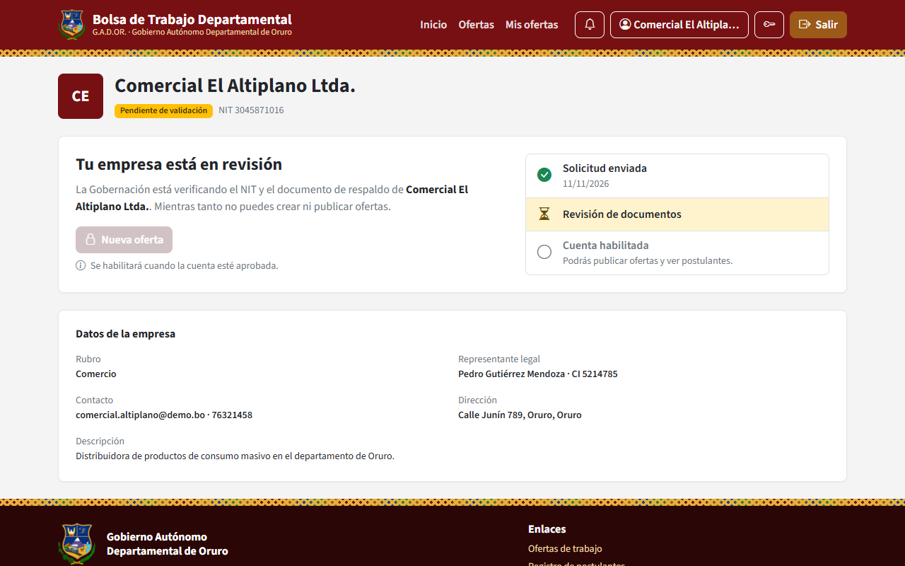

### 3.2 Crear una oferta

1. Entra a **Mis ofertas** y pulsa **Nueva oferta**.
2. Completa: título, descripción, requisitos obligatorios y deseables, profesiones (una o varias), años de experiencia, tipo de contrato, modalidad, municipio, salario (mínimo y máximo, o marca **A tratar**), beneficios, fecha de cierre y número de plazas.
3. Agrega las **habilidades** que pides y marca cuáles son **obligatorias** y cuáles **deseables**. Con ellas se calcula la coincidencia de cada postulante (una obligatoria vale el doble que una deseable).
4. Guarda: la oferta queda en **Borrador**. Puedes editarla las veces que quieras.
5. Cuando esté lista, pulsa **Enviar a revisión**. La oferta pasa a **En revisión** y ya no se puede editar.

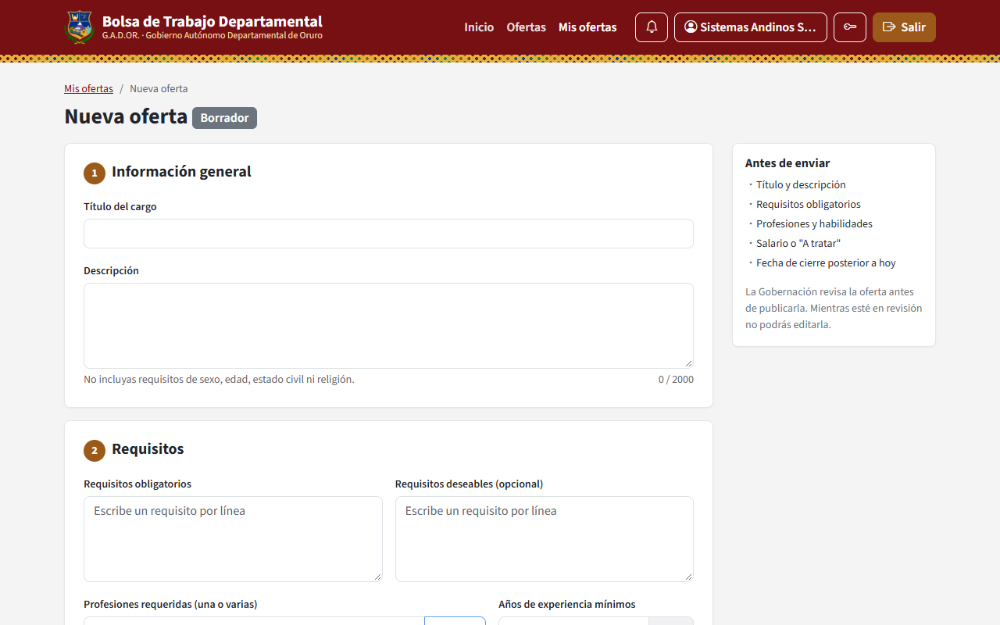

### 3.3 Estados de una oferta

| Estado | Qué significa | Qué puedes hacer |
|---|---|---|
| Borrador | En preparación | Editar, enviar a revisión, anular |
| En revisión | La Gobernación la está revisando | Esperar la respuesta o anular |
| Publicada | Visible para todos y recibe postulaciones | Ver postulantes, cerrar, anular |
| En proceso de selección | Pasó la fecha de cierre: ya no recibe postulaciones | Evaluar postulantes, cerrar, anular |
| Cerrada | Terminó el proceso | Ver postulantes |
| Anulada | Se canceló | Ver postulantes |

- Si la Gobernación **devuelve** la oferta, vuelve a **Borrador** con una **Observación de la Gobernación**. Corrígela y envíala de nuevo.
- **Duplicar** (disponible en cualquier estado) crea una copia nueva en Borrador, útil para repetir una convocatoria.
- Hay un **límite de ofertas activas** (en revisión, publicadas y en selección). Lo fija la Gobernación (5 por defecto) y se ve en tu panel. Para enviar otra, cierra o anula una.

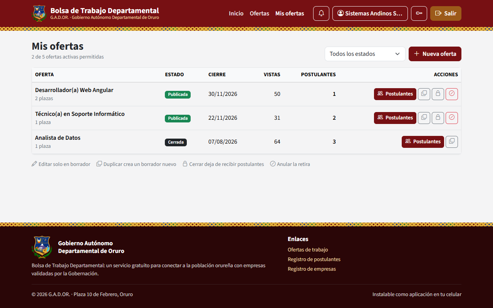

### 3.4 Revisar postulantes

1. En **Mis ofertas**, pulsa **Postulantes** en la oferta.
2. Los postulantes aparecen ordenados por **coincidencia**, de mayor a menor, con su foto, profesión, años de experiencia y estado. Los nuevos llevan la marca **Nuevo**.
3. Pulsa **Ver perfil** para abrir la hoja de vida completa: formación, experiencia, idiomas y **Habilidades frente a la oferta** (cuáles cumple y cuáles le faltan).
4. Al abrir el perfil por primera vez la postulación pasa a **Visto** y el postulante recibe un aviso.
5. Pulsa **Ver CV (PDF)** para abrir su hoja de vida.
6. En **Estado de la postulación** elige el siguiente paso: preseleccionado, entrevista, finalista, contratado o rechazado. El postulante recibe un aviso y un correo con cada cambio.

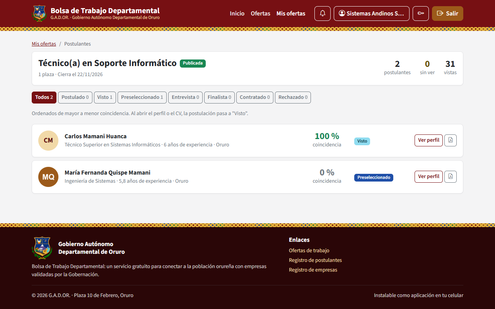

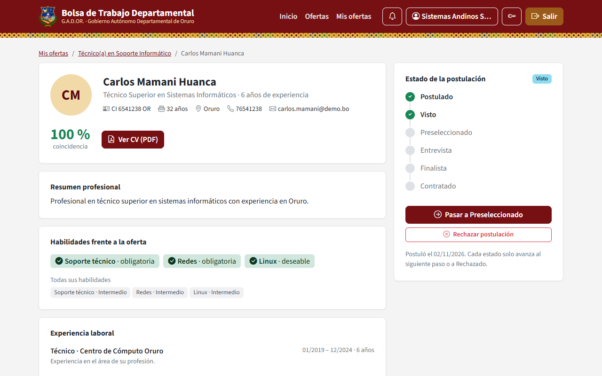

### 3.5 Empresa suspendida

Si la Gobernación suspende la empresa verás **Tu cuenta está suspendida**. No puedes crear, editar ni enviar ofertas, pero sí cerrar o anular las que tienes.

## 4. Administrador de la Gobernación

El administrador entra con la cuenta creada al instalar el sistema. Al iniciar sesión ve el **Dashboard**. El menú tiene **Dashboard**, **Empresas**, **Ofertas por revisar** y el desplegable **Administración** (Reportes, Catálogos, Configuración y Auditoría).

### 4.1 Dashboard

Muestra, calculado en el momento:

- Postulantes registrados, empresas aprobadas y pendientes, ofertas activas, publicadas y cerradas en el mes.
- **Tasa de contratación:** postulaciones contratadas sobre el total de postulaciones.
- Gráfico de postulaciones de los últimos 6 meses (el mes en curso en amarillo), postulantes por profesión y empresas por rubro.
- Accesos directos a las empresas que esperan validación y a las ofertas en revisión.

Pulsa **Actualizar** para recalcular.

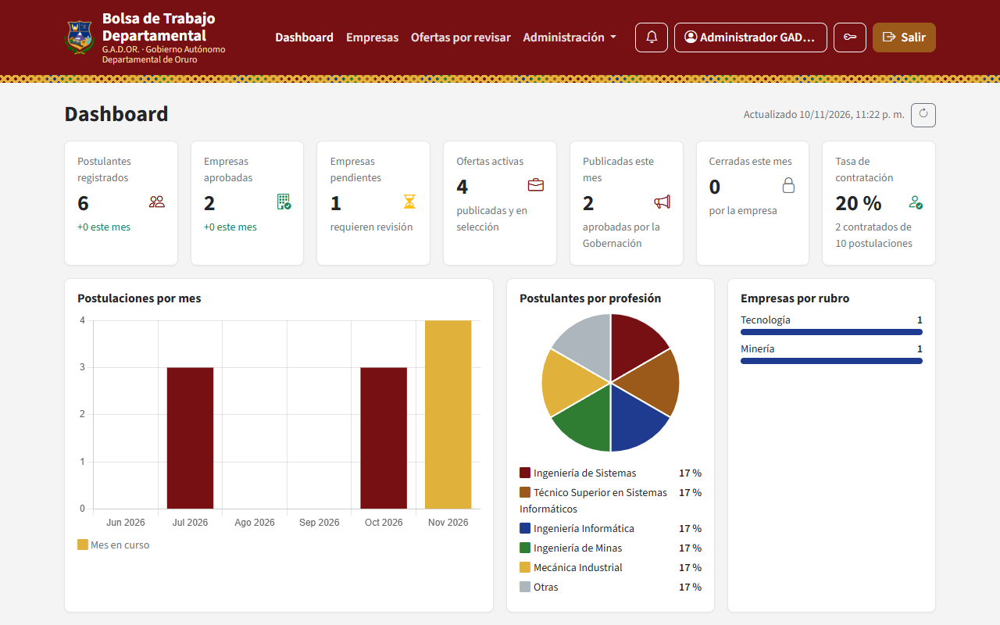

### 4.2 Validar empresas

1. Entra a **Empresas**. Las pestañas separan las empresas por estado: pendientes, aprobadas, rechazadas y suspendidas.
2. Pulsa una empresa para ver sus datos.
3. En **Documento de respaldo**, pulsa **Ver documento** para abrir el PDF del NIT y compararlo con los datos.
4. Decide:
   - **Aprobar:** la empresa ya puede publicar ofertas.
   - **Rechazar:** escribe el **motivo** (obligatorio); la empresa lo verá.
   - **Suspender** (solo empresas aprobadas): deja de crear y enviar ofertas.
   - **Reactivar** (solo empresas suspendidas): vuelve a quedar aprobada.
5. La empresa recibe un aviso y un correo con la decisión. Todo queda en la auditoría.

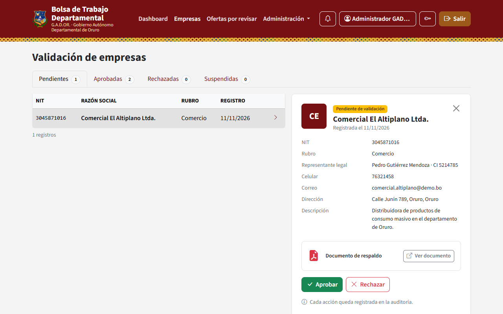

### 4.3 Revisar ofertas

1. Entra a **Ofertas por revisar**. Las más antiguas aparecen primero.
2. Elige una oferta para ver la **vista previa** tal como la verán los postulantes.
3. Decide:
   - **Aprobar y publicar:** la oferta se publica y se avisa a los postulantes de esas profesiones.
   - **Devolver con observación:** escribe la observación (obligatoria al devolver); la oferta vuelve a Borrador.

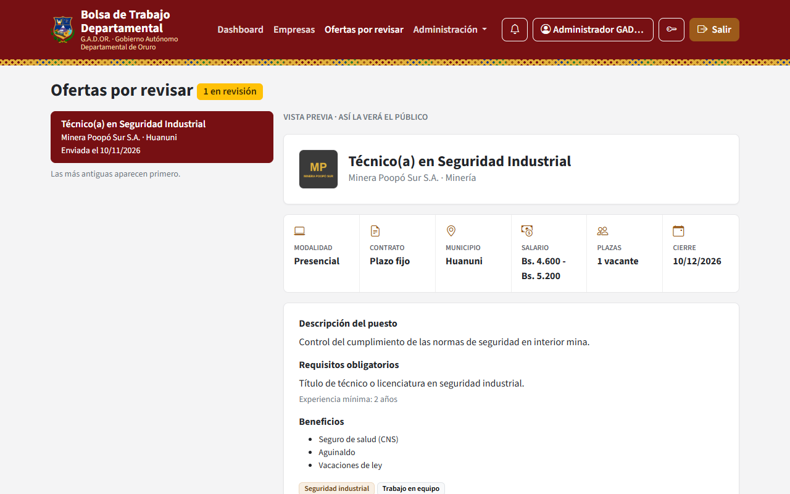

### 4.4 Reportes

1. Entra a **Administración → Reportes**.
2. Elige el reporte: **Empresas**, **Postulantes**, **Ofertas por fecha** o **Contrataciones por empresa**.
3. Ajusta las fechas (déjalas vacías para todo el historial) y el filtro de estado, municipio o rubro.
4. Pulsa **Exportar Excel** o **Exportar PDF**. El archivo lleva el membrete de la Gobernación, la fecha de emisión y tu nombre.

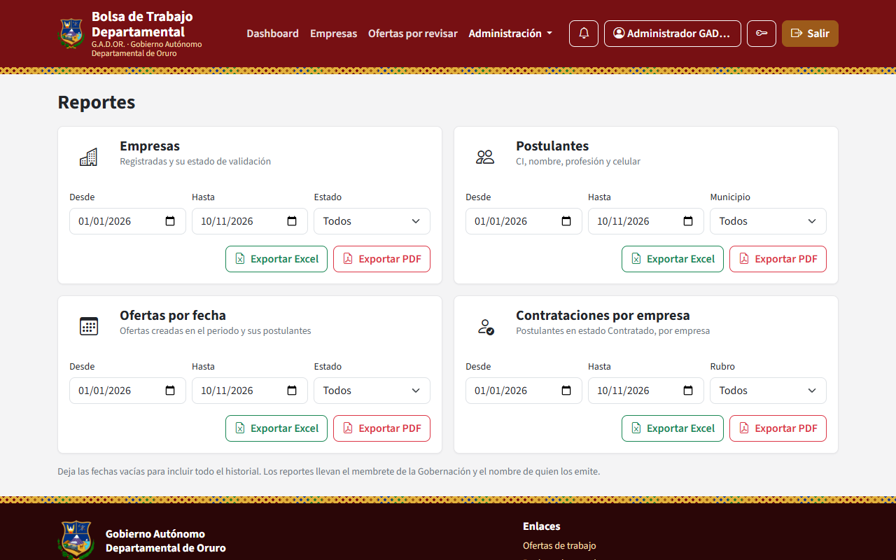

### 4.5 Catálogos

1. Entra a **Administración → Catálogos**.
2. Elige la pestaña: rubros, profesiones, habilidades, tipos de contrato, modalidades, departamentos, municipios o idiomas.
3. Usa el buscador o el filtro de estado.
4. **Agregar:** pulsa el botón de agregar, escribe el nombre (en municipios, elige el departamento; en habilidades, la categoría) y guarda.
5. **Editar:** pulsa el lápiz.
6. **Desactivar o activar:** pulsa el interruptor. Desactivar no borra los datos: solo oculta la opción en los formularios nuevos.

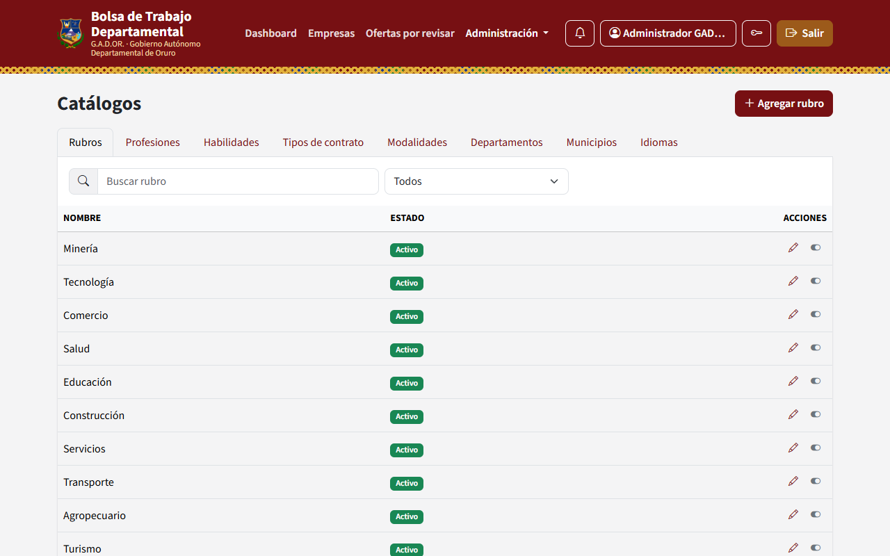

### 4.6 Configuración

1. Entra a **Administración → Configuración**.
2. Cambia el **Límite de ofertas activas por empresa** (entre 1 y 50) y pulsa **Guardar**.
3. La pantalla indica cuántas empresas ya llegaron al límite y quién hizo el último cambio. Al bajar el límite no se cierra ninguna oferta existente.

### 4.7 Auditoría

1. Entra a **Administración → Auditoría**.
2. Filtra por fechas, usuario (correo o nombre), acción y tabla, y pulsa **Filtrar**.
3. Pulsa un evento para ver el detalle: quién, cuándo, desde qué IP, los datos anteriores, los datos nuevos y los campos que cambiaron.

Se registran los inicios de sesión, las validaciones de empresas, los cambios de estado de ofertas y postulaciones, y los cambios de catálogos y configuración. Los eventos sin usuario los hizo el sistema (por ejemplo, el cierre automático de ofertas vencidas).

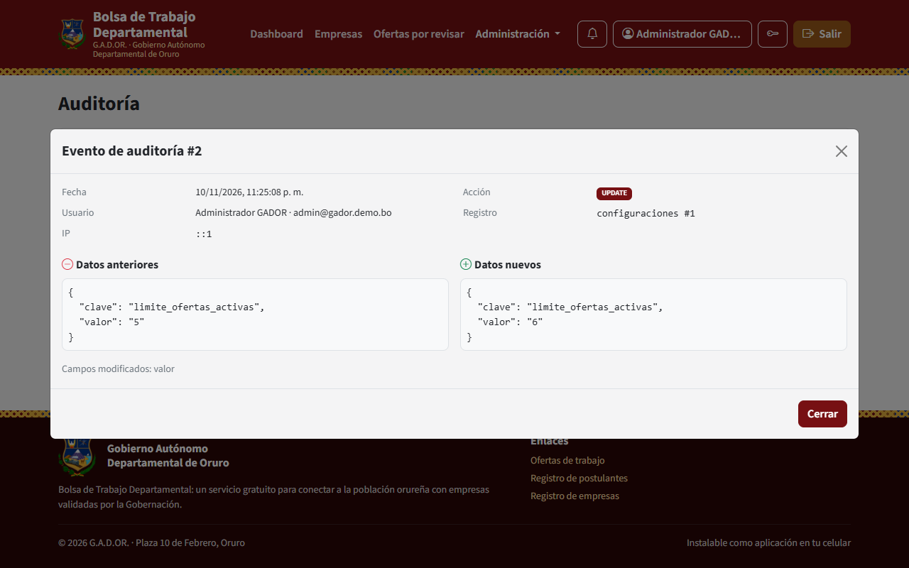

## 5. Preguntas frecuentes

**No me llega el código o el enlace por correo.**
Revisa las carpetas **Spam** y **Promociones**. Puedes pedir otro código después de 1 minuto.

**La página tarda en cargar la primera vez.**
En la demo, el servidor se suspende cuando no tiene visitas y tarda cerca de un minuto en reactivarse. Después funciona con normalidad.

**No puedo postular aunque mi perfil dice 80 %.**
Se necesita **más de 80 %** y el CV en PDF cargado.

**No me aparece el botón de Activar avisos.**
Usa Chrome (o la aplicación instalada). En iPhone, los avisos solo funcionan con la aplicación agregada a la pantalla de inicio (iOS 16.4 o superior). Si bloqueaste los avisos, permítelos desde el candado junto a la dirección del sitio.

**Mi oferta ya no aparece en el listado público.**
Pasó su fecha de cierre y está en **proceso de selección**: ya no recibe postulaciones, pero sigues viendo a tus postulantes.

**Necesito ayuda.**
Comunícate con la Unidad de Sistemas e Informática del Gobierno Autónomo Departamental de Oruro.
